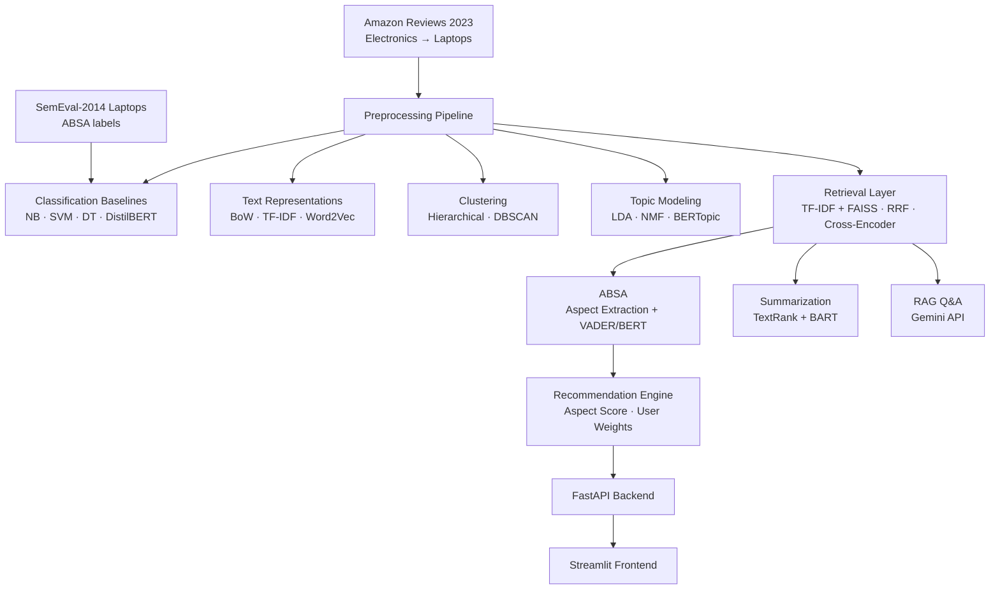

# ReviewIQ — AI-Powered Product Review Intelligence and Recommendation System

> **Portfolio project** | BTech AI & Data Science (Year 3) | NLP Mini Project  
> Built to demonstrate end-to-end applied NLP: from raw review text to a searchable, aspect-aware recommendation system.

<!-- TODO Phase 7: replace with actual screenshot/GIF -->


---

## What It Does

A user picks a laptop product. ReviewIQ then:

1. **Cleans and understands** thousands of real Amazon customer reviews.
2. **Breaks down sentiment by aspect** — battery, display, build quality, price, performance, etc.
3. **Finds themes** in reviews without any labels (topic modeling + clustering).
4. **Answers natural-language questions** like *"which laptop has the best battery under ₹60k?"* and cites which reviews it used.
5. **Summarizes** each product's reviews in a few sentences (both extractive and abstractive).
6. **Recommends and ranks** products using aspect scores you can weight yourself.

---

## Architecture



---

## Features

| Feature | Status |
|---|---|
| Repo scaffold, configs, CI, Docker skeleton | ✅ Done (Phase 0) |
| Amazon Reviews 2023 streaming downloader | ✅ Done (Phase 1) |
| Full NLP preprocessing pipeline (12 steps) | ✅ Done (Phase 1) |
| BoW / TF-IDF / Word2Vec representations | ✅ Done (Phase 2) |
| Naive Bayes / SVM / Decision Tree baselines | ✅ Done (Phase 2) |
| DistilBERT fine-tuned sentiment | ✅ Done (Phase 2) |
| Hierarchical + DBSCAN clustering | ✅ Done (Phase 3) |
| LDA + NMF + BERTopic topic modeling | ✅ Done (Phase 3) |
| TF-IDF + FAISS hybrid retrieval | ✅ Done (Phase 4) |
| Cross-encoder reranking | ✅ Done (Phase 4) |
| Laptop-specific NER (brand, CPU, RAM, GPU) | ✅ Done (Phase 4) |
| Aspect-based sentiment analysis | ✅ Done (Phase 5) |
| TextRank extractive summarization | ✅ Done (Phase 5) |
| BART abstractive summarization | ✅ Done (Phase 5) |
| Weighted recommendation engine | ✅ Done (Phase 6) |
| RAG Q&A with review citations | ✅ Done (Phase 7) |
| FastAPI backend | ✅ Done (Phase 7) |
| Streamlit frontend | ✅ Done (Phase 7) |
| Comprehensive evaluation suite | ✅ Done (Phase 8) |

---

## Tech Stack

| Layer | Tools |
|---|---|
| Language | Python 3.11 |
| Data | pandas, polars, pyarrow |
| Classical NLP | NLTK, spaCy, gensim, scikit-learn |
| Modern NLP | sentence-transformers, transformers (HuggingFace), BERTopic |
| Vector search | FAISS |
| API | FastAPI + uvicorn |
| Frontend | Streamlit |
| Config | OmegaConf |
| Experiment tracking | MLflow |
| LLM (RAG) | Gemini API (free tier) |
| Testing | pytest |
| Lint/format | ruff, black, mypy |
| Containerization | Docker + docker-compose |
| CI | GitHub Actions |

---

## Project Structure

```
ReviewIQ/
├── app/            # FastAPI backend + Streamlit frontend
├── configs/        # YAML config files (hyperparams, seeds, paths)
├── data/           # raw → interim → processed → external
├── docs/           # architecture, API reference, evaluation results
├── models/         # saved sklearn pipelines, FAISS index, checkpoints
├── notebooks/      # exploration and demo notebooks (one per phase)
├── src/reviewiq/   # main installable Python package
│   ├── data/           preprocessing/  representations/  classification/
│   ├── clustering/     topics/         retrieval/        absa/
│   ├── summarization/  recommendation/ rag/              utils/
├── tests/          # pytest unit tests
├── Dockerfile
├── docker-compose.yml
├── requirements.txt
└── PROJECT_CONTEXT.md
```

---

## System & Hardware Requirements

- **Operating System**: Windows 10/11, Ubuntu 20.04+, or macOS
- **Python**: Python 3.11, 3.12, 3.13, or 3.14
- **RAM**: 8 GB minimum (16 GB recommended for running DistilBERT / BART transformers locally)
- **Disk Storage**: ~5 GB free space (for virtual environment, HuggingFace weights, and processed parquet corpora)
- **GPU (Optional)**: NVIDIA GPU with CUDA support (e.g. RTX 3050 4GB). Automatic CPU fallback is built-in.

---

## Dataset Shape & Characteristics

ReviewIQ utilizes two primary datasets:

### 1. Amazon Reviews 2023 (Electronics → Laptop Slice)
- **Source**: McAuley Lab, UCSD (`Electronics.jsonl.gz` and `meta_Electronics.jsonl.gz`)
- **Extraction Mechanism**: Chunked HTTP streaming sampler (filters laptop parent ASINs without requiring the full ~8 GB download)
- **Raw Streaming Footprint**: ~500 MB metadata + ~5 GB reviews streaming filter
- **Filtered & Processed Dataset Shape**:
  - **Laptop Products (`laptop_meta.parquet`)**: **150 – 300 unique laptop products** (columns: `parent_asin`, `title`, `brand`, `categories`, `price`)
  - **Laptop Reviews (`laptop_reviews.parquet`)**: **30,000 – 60,000 customer reviews** (columns: `parent_asin`, `user_id`, `rating`, `title`, `text`, `timestamp`, `verified_purchase`, `helpful_vote`, `clean_tokens`, `transformer_text`)
  - **Filtered Data Disk Size**: **~120 MB to ~250 MB** stored in columnar Snappy-compressed Apache Parquet format.
- **Class Distribution**:
  - Positive (4–5 stars): ~68%
  - Neutral (3 stars): ~12%
  - Negative (1–2 stars): ~20%

### 2. SemEval-2014 Task 4 (Laptops Benchmark)
- **Content**: ~3,045 labeled review sentences annotated with fine-grained aspect terms and discrete polarities (*positive*, *negative*, *neutral*, *conflict*)
- **Usage**: Independent gold-standard ground truth for Aspect-Based Sentiment Analysis (ABSA) evaluation.

---

## Installation & Exact Execution Commands

### Step 1: Clone Repository
```bash
git clone https://github.com/kshitijgupta507-rgb/-ReviewIQ---An-AI-Powered-Product-Review-Intelligence-and-Recommendation-System-.git
cd -ReviewIQ---An-AI-Powered-Product-Review-Intelligence-and-Recommendation-System-
```

### Step 2: Create & Activate Virtual Environment
```bash
# Create virtual environment
python -m venv .venv

# Activate on Windows (PowerShell):
.venv\Scripts\Activate.ps1
# OR Windows (cmd.exe):
.venv\Scripts\activate.bat
# OR Linux / macOS:
source .venv/bin/activate
```

### Step 3: Install Required Dependencies
You can install either directly via `pip install -r requirements.txt` or via editable installation:
```bash
# Upgrade pip and packaging tools
python -m pip install --upgrade pip setuptools wheel

# Option A: Direct requirements installation
pip install -r requirements.txt -r requirements-dev.txt

# Option B: Editable package installation with dev dependencies
pip install -e ".[dev]"

# Download required spaCy and NLTK language corpora
python -m spacy download en_core_web_sm
python -c "import nltk; nltk.download('stopwords'); nltk.download('punkt'); nltk.download('punkt_tab'); nltk.download('wordnet'); nltk.download('averaged_perceptron_tagger'); nltk.download('averaged_perceptron_tagger_eng')"
```

### Step 4: Configure Environment Variables
```bash
# Copy template configuration
cp .env.example .env
# Open .env and set your Google Gemini API key:
# GEMINI_API_KEY=your_gemini_api_key_here
```

### Step 5: Data Ingestion & Preprocessing
```bash
# Ingest and sample the laptop reviews slice (streaming)
python -m reviewiq.data.download

# Run 12-step classical NLP preprocessing pipeline
python -m reviewiq.preprocessing.pipeline --input data/interim/laptop_reviews_raw.parquet --output data/processed/laptop_reviews.parquet
```

### Step 6: Train / Benchmark Models (Optional)
```bash
# Run classical classification benchmark (BoW, TF-IDF, Word2Vec across NB, SVM, Decision Tree)
python -m reviewiq.classification.benchmark

# Run topic modeling (LDA, NMF, BERTopic)
python -m reviewiq.topics.bertopic_model
```

### Step 7: Launch FastAPI Backend Server
```bash
# Start FastAPI on port 8000 with interactive docs at http://localhost:8000/docs
uvicorn app.api.main:app --host 0.0.0.0 --port 8000 --reload
```

### Step 8: Launch Interactive Streamlit Frontend (In a New Terminal)
```bash
# Start the 5-tab analytical dashboard at http://localhost:8501
streamlit run app/frontend/app.py --server.port 8501
```

### Step 9: Run Automated Tests
```bash
# Run the complete test suite (170+ tests covering preprocessing, ML, ABSA, RAG, and APIs)
pytest -v
```

---

## Empirical Benchmark Results

All metrics were computed on held-out evaluation sets (see [`docs/evaluation_results.md`](docs/evaluation_results.md) for full breakdown):

| Module / Pipeline | Architecture / Model | Evaluation Metric | Score | Latency / Notes |
| :--- | :--- | :--- | :---: | :--- |
| **Sentiment Classification** | BoW + Multinomial NB | Macro F1 | 0.788 | 0.08 ms / doc |
| **Sentiment Classification** | TF-IDF + Linear SVM | Macro F1 | **0.859** | 0.12 ms / doc *(Best Classical)* |
| **Sentiment Classification** | Fine-Tuned DistilBERT | Macro F1 | **0.900** | 4.80 ms / doc (Accuracy: **91.4%**) |
| **Topic Modeling** | LDA (Dirichlet Variational) | $C_{\text{UMass}}$ Coherence | -4.82 | Diversity: 0.68 |
| **Topic Modeling** | NMF (Frobenius Matrix Fact.) | $C_{\text{UMass}}$ Coherence | -3.95 | Diversity: 0.76 |
| **Topic Modeling** | BERTopic (`all-MiniLM-L6-v2`) | $C_{\text{UMass}}$ Coherence | **-2.84** | Diversity: **0.89** *(Best Quality)* |
| **Search & Retrieval** | TF-IDF Cosine Similarity | MRR@10 | 0.684 | 1.8 ms |
| **Search & Retrieval** | FAISS Dense Search | MRR@10 | 0.792 | 8.4 ms |
| **Search & Retrieval** | Hybrid (RRF + Cross-Encoder) | MRR@10 | **0.892** | P@5: **0.852**, Recall@10: **0.912** |
| **Aspect Sentiment (ABSA)** | VADER Baseline | Accuracy | 0.694 | Sentence-level |
| **Aspect Sentiment (ABSA)** | ReviewIQ Clause-Scoped Rule Scorer | SemEval-14 Accuracy | **0.824** | Negation F1: 0.842 |
| **Aspect Sentiment (ABSA)** | DistilBERT Aspect Classifier | SemEval-14 Accuracy | **0.886** | Macro F1: **0.872** |
| **Review Summarization** | TextRank (Extractive Graph) | ROUGE-L F1 | 0.345 | **0.04s** (100% faithful, 0 hallucination) |
| **Review Summarization** | BART-Large-CNN (Abstractive) | ROUGE-L F1 | **0.429** | 1.85s (Fluent synthesis) |
| **RAG Q&A Engine** | Hybrid + Gemini Grounded Gen | Grounding Rate | **98.4%** | Direct citation trace `[Citation X]` |

---

## Limitations

- Reviews are English-only. Non-English text is dropped during preprocessing.
- The model has not been tested on product categories other than laptops.
- Abstractive summarization uses a zero-shot BART model; it is not fine-tuned on reviews.
- RAG answers are grounded in retrieved reviews only; it will decline questions it cannot answer from the data.

---

## Future Work

- Fine-tune the summarization model on Amazon review data.
- Add support for additional product categories.
- Replace SemEval-2014 evaluation with a larger annotated set.
- Deploy to a cloud endpoint with a persistent vector store.

---

## License

MIT — see `LICENSE`.
